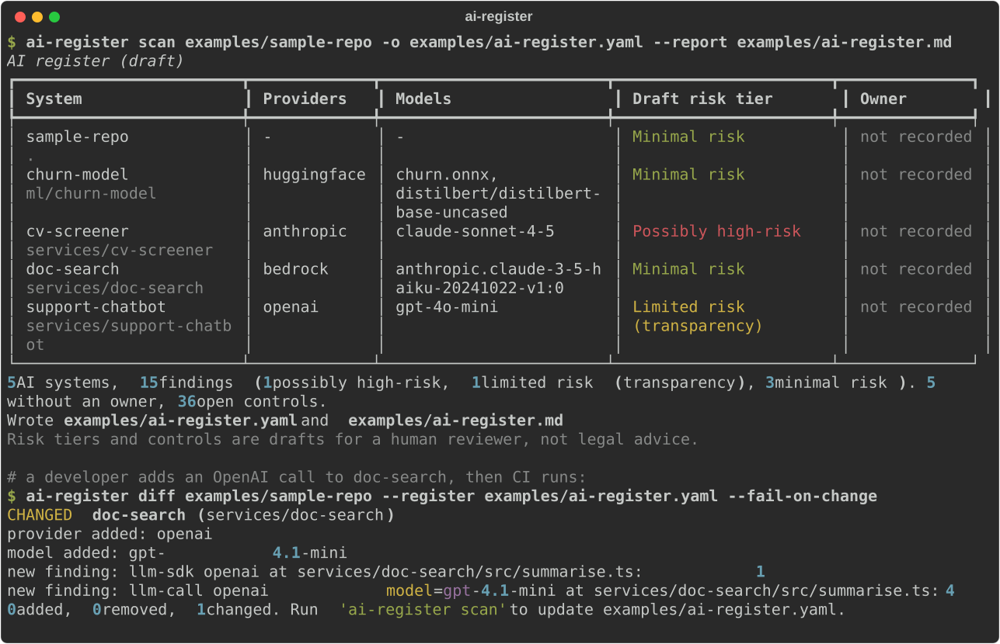
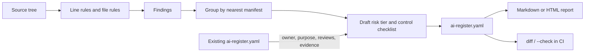

# ai-register

Scan a codebase, list every AI system it contains, and keep that list as a register your governance team can review, sign off and diff in CI.



▶ [Watch the 50-second demo video](https://github.com/sumankrsh/ai-register/releases/latest/download/demo.mp4)

## The problem

The EU AI Act and ISO/IEC 42001 both start with the same question: which AI systems do you run? In most organisations the answer is a spreadsheet that someone filled in once. Developers add a new model call in a pull request, and the spreadsheet never hears about it.

Existing AI bill-of-materials scanners answer a security question (which packages, which vulnerabilities). An auditor asks something different: what is this system for, who owns it, what risk tier is it, and which controls have evidence. `ai-register` builds that register from the code, lets people fill in the parts code can't tell you, and keeps their answers when it scans again.

## Quickstart

```bash
git clone https://github.com/sumankrsh/ai-register && cd ai-register
pip install .
ai-register scan examples/sample-repo --report ai-register.md
```

That scans the synthetic sample repo in `examples/`, writes `ai-register.yaml` and a Markdown report, and prints a summary table. On the sample repo it finds 5 systems and 15 findings, including a CV screener drafted as possibly high-risk under Annex III point 4. Open [examples/ai-register.md](examples/ai-register.md) to see a full report without installing anything.

To scan your own code, point it at a folder: `ai-register scan path/to/repo`.

## Features

- **Finds AI usage** in Python, Jupyter notebooks and JavaScript/TypeScript:
  - SDK imports and model calls for OpenAI, Azure OpenAI, Anthropic, AWS Bedrock, Google Vertex AI and Gemini, Hugging Face, LangChain and LlamaIndex
  - model names written as string literals (`gpt-4o-mini`, `claude-sonnet-4-5`, Bedrock model ids, `org/model` ids next to `from_pretrained`)
  - model files (`.gguf`, `.safetensors`, `.onnx`, `.pt`, `.h5` and others)
  - prompt templates (`.prompt`, `.prompty`, files in a `prompts/` folder, `SYSTEM_PROMPT = ...` in code)
  - vector stores (Chroma, Pinecone, FAISS, Weaviate, Qdrant, pgvector, LanceDB, Milvus)
  - MCP configs (`.mcp.json`, `mcp.json`, any JSON with `mcpServers`), with the server names
- **Records file, line, provider and model** for every finding, plus data-handling hints: personal-data field names (email, date_of_birth, iban and others) and outbound HTTP calls within 25 lines.
- **Groups findings into systems** by the nearest project manifest (`pyproject.toml`, `package.json`, `requirements.txt`, `go.mod` and others), named from the manifest where it can be read.
- **Drafts an EU AI Act risk tier** for each system: possibly prohibited (Art. 5), possibly high-risk (Annex III), limited risk (Art. 50) or minimal risk. Every tier lists the words that triggered it and where they are, so a reviewer can check it in seconds.
- **Drafts an ISO/IEC 42001 Annex A checklist** per system, chosen from what was found: a third-party model adds supplier review (A.10.3), personal data adds impact and provenance controls (A.5.4, A.7.5), and so on. Each item says why it is there.
- **Keeps human answers.** Owner, purpose, reviewed tier, reviewer notes, and each control's status and evidence survive every re-scan. A purpose typed in by a person is also screened, so writing "shortlists job applicants" moves the draft tier to possibly high-risk.
- **Never silently drops a system.** If code disappears, its entry stays with `lifecycle: not-detected` and its last known findings.
- **Runs in CI.** `ai-register diff --fail-on-change` lists new providers, models, findings and tier changes against the committed register. `ai-register scan --check` fails when the register is out of date.
- **Reports** in Markdown or as a single-file HTML page (`ai-register report ai-register.yaml -o register.html`).
- Fully offline. No API keys, no network calls.

## How it works



1. Every file under the folder is walked, skipping `.git`, `node_modules`, virtual environments and build output. Files over 1 MB and binary files are skipped for text rules.
2. Each line of code is checked against a small set of regular expressions in [src/ai_register/detectors.py](src/ai_register/detectors.py). Comment-only lines are ignored. Model names are attached to the nearest call.
3. Findings are grouped into systems. The risk screen in [src/ai_register/risk.py](src/ai_register/risk.py) looks for wording tied to specific articles (for example "rank candidates" for Annex III point 4, "credit score" for point 5(b), "chatbot" for Art. 50(1)) in the system's code, prompts and recorded purpose. The most serious match wins.
4. If a register already exists, the fields people own are carried across before the file is written.
5. Diffs compare findings by kind, provider, file, model and the text of the line, so code moving up or down a file is not reported as a change.

### Using it in CI

Commit `ai-register.yaml` and add a step:

```yaml
- run: pip install git+https://github.com/sumankrsh/ai-register
- run: ai-register diff . --register ai-register.yaml --fail-on-change
```

A pull request that adds a new model call then fails with the exact change, and the author updates the register in the same pull request.

## Configuration

| Option | Command | What it does |
|---|---|---|
| `-o, --output FILE` | `scan` | Register file to write or update. Default `ai-register.yaml`. |
| `-r, --report FILE` | `scan` | Also write a report; `.html` gives HTML, anything else Markdown. |
| `-x, --exclude GLOB` | `scan`, `diff` | Skip matching files or folders, e.g. `-x tests -x "*.min.js"`. Repeatable. |
| `--check` | `scan` | Write nothing; exit 1 if the register would change. |
| `--register FILE` | `diff` | Register to compare against. Default `ai-register.yaml`. |
| `--fail-on-change` | `diff` | Exit 1 when anything changed. |
| `-o, --output`, `-f, --format md\|html` | `report` | Render an existing register. |

Fields you edit in `ai-register.yaml`, per system:

```yaml
owner: Customer Operations
purpose: Answers parcel-tracking questions from customers
review_status: reviewed          # free text; "draft" until someone changes it
risk:
  reviewed_tier: limited-risk    # overrides the draft tier everywhere
  reviewer_notes: AI disclosure shown in the chat header
controls:
  - id: A.3.2
    status: done                 # "done" ticks the box in reports
    evidence: RACI v2, signed off 2026-09-12
```

Everything else is regenerated on each scan.

## Limitations

- **The risk tier is a keyword screen, not a legal assessment.** It can miss a high-risk use case that the code never names, and it can flag a system that only mentions a term. Every tier is labelled draft and must be reviewed by a person. The default when nothing matches is minimal risk, and the reasoning says so.
- ISO/IEC 42001 control titles are short paraphrases of the Annex A headings. Check them against your own copy of the standard. The checklist is a starting point, not a full Statement of Applicability.
- Detection is static and line-based. It will not see a provider reached only through a generic HTTP client, a model name built at runtime, or a model chosen by configuration outside the scanned folder.
- Only Python, notebooks and JavaScript/TypeScript are scanned for code rules. Java, Go, C# and others only get the file-level rules (model files, prompt files, MCP configs).
- Line numbers in notebooks count lines of code cells, not lines of the `.ipynb` file.
- String literals still count. Scanning this tool's own source, which contains every rule as text, gives one false finding (measured by running `ai-register scan . -x examples -x tests` in this repo). Use `--exclude` for folders like that.
- Personal-data hints are field names near an AI call. They show where to look, not proof that personal data reaches a model.

## More tools

Part of a small family of open-source tools for running AI with governance built in:

- **ai-register**: this tool, the AI inventory.
- **mcp-gatekeeper**: permissions, approvals and a tamper-evident audit log for MCP tool calls.
- **agentbreak**: tests whether an attack makes an agent take an unauthorised action.
- **prompt-ci**: prompts as version-controlled code with tests.
- **ai-policy-lint**: checks agent and prompt configs against a written AI policy.

See [github.com/sumankrsh](https://github.com/sumankrsh) for the ones published so far.

## Credits

No code was adapted from other projects. Article and Annex references are to Regulation (EU) 2024/1689 (the EU AI Act). Control references are to ISO/IEC 42001:2023 Annex A. The sample repo in `examples/` is synthetic: every company, person and data field in it is made up.

## Licence

MIT. See [LICENSE](LICENSE).
